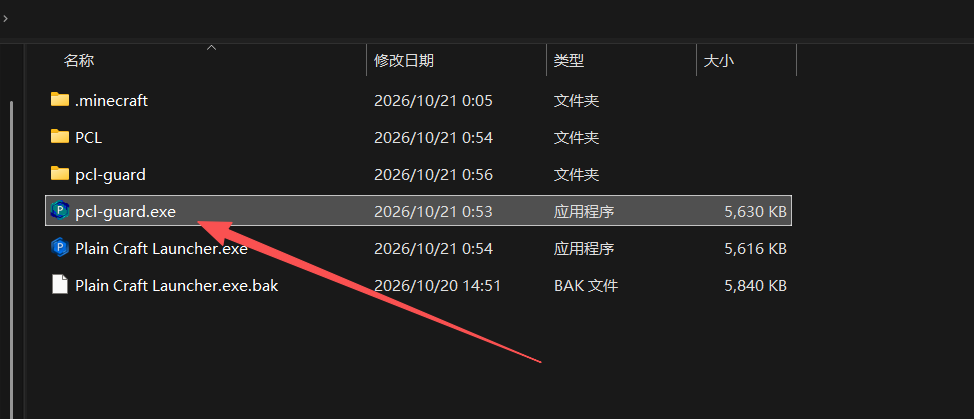

# pcl-guard

纯净的 Plain Craft Launcher 2 (PCL2) 运行环境守护与版本回退工具。



---

## 极简使用说明

**只需两步，小白也能一秒搞定：**

1. **放对位置**：把 `pcl-guard.exe` 复制到你的 PCL2 启动器同一文件夹下（即和 `Plain Craft Launcher.exe` 放在一起，如上图所示）。
2. **双击运行**：直接双击 `pcl-guard.exe` 即可！

它会自动为你完成以下所有防护工作，完成后直接退出，绝不打扰你游玩：
- **锁定关闭自动更新**：自动将 `PCL\Setup.ini` 中的更新配置修改为彻底关闭更新提示与后台下载（`SystemSystemUpdate:3`），已有存档和配置绝不损坏。
- **校验并回退版本**：如果启动器被意外更新或修改，它会自动把旧文件安全备份到 `PCL\Backup\`，并一秒将主程序无损回退到 2.13.1.1 黄金基准版本。
- **运行中程序保护**：如果 PCL 或游戏正开着，它会主动弹窗询问你是否先退出程序，绝不盲目强退。

> **日常游戏提醒**：平时玩游戏时，直接双击运行你的 `Plain Craft Launcher.exe` 即可。随时想要检查防更或自愈修复，双击一下 `pcl-guard.exe` 即可。

---

## 高级用法：静默模式

如果你想在批处理脚本或快捷方式中静默运行（不弹出任何提示框）：

```cmd
pcl-guard.exe /silent
```

支持 `/silent`、`-s`、`--silent`、`-q` 参数。

---

## 下载最新版

在项目的 [Releases](../../releases) 页面可以直接下载编译打包好的独立程序：
- `pcl-guard.exe`：单文件独立程序（内嵌母本与高清图标，无需安装任何运行库）
- `sha256.txt`：官方哈希校验和文件

---

## 核心机制与技术指标

- **官方基准版本**：`2.13.1.1`
- **基准二进制 SHA256**：`30EB93C62FC51EDE0898648E67455478A3D5A4F279938AE65AEC77B84CB9703F`
- **覆盖前自动备份路径**：`PCL\Backup\Plain Craft Launcher_{时间戳}.exe.bak`
- **文件属性策略**：标准普通文件属性，不施加只读限制
- **CI/CD**：通过 GitHub Actions 虚拟机原生自动化编译与 Tag 发版

---

## 许可证

本项目依据 MIT 许可证开源。
